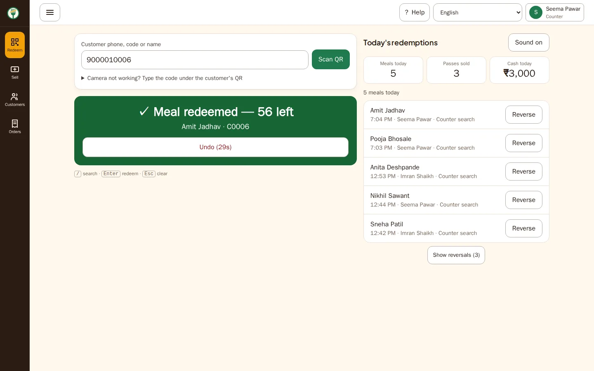
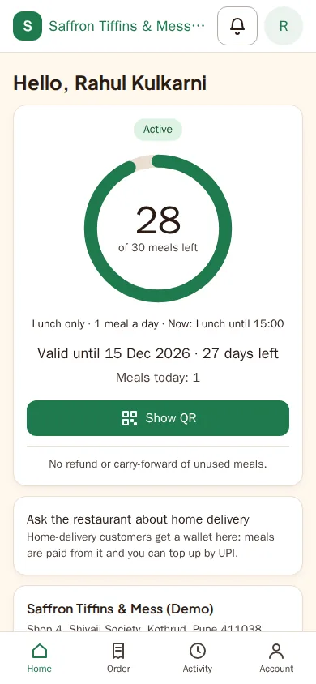
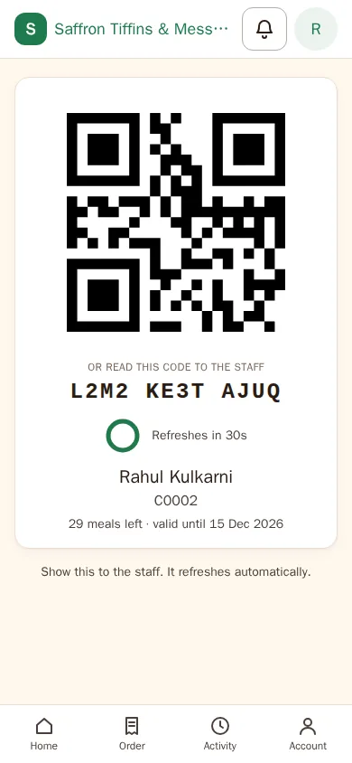
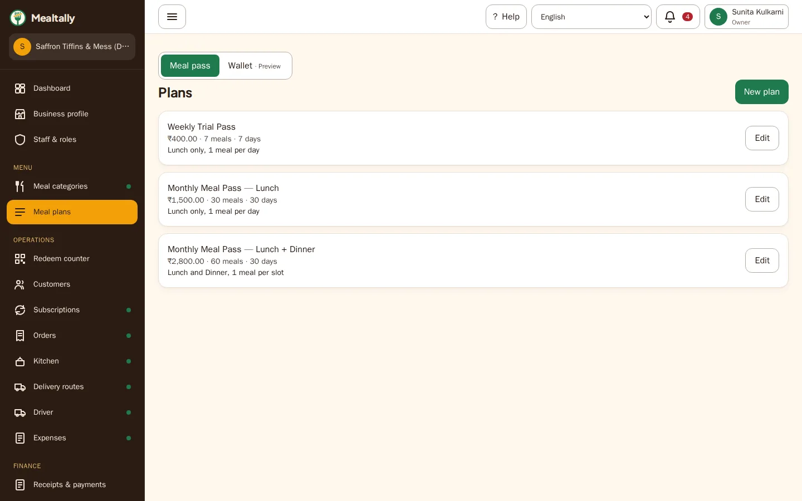
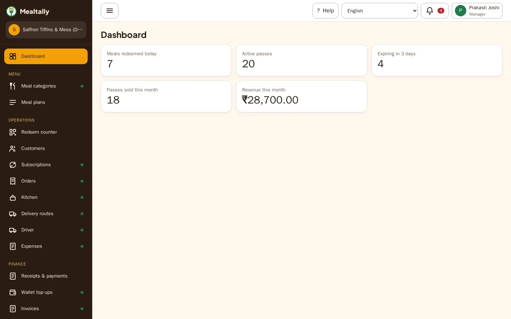
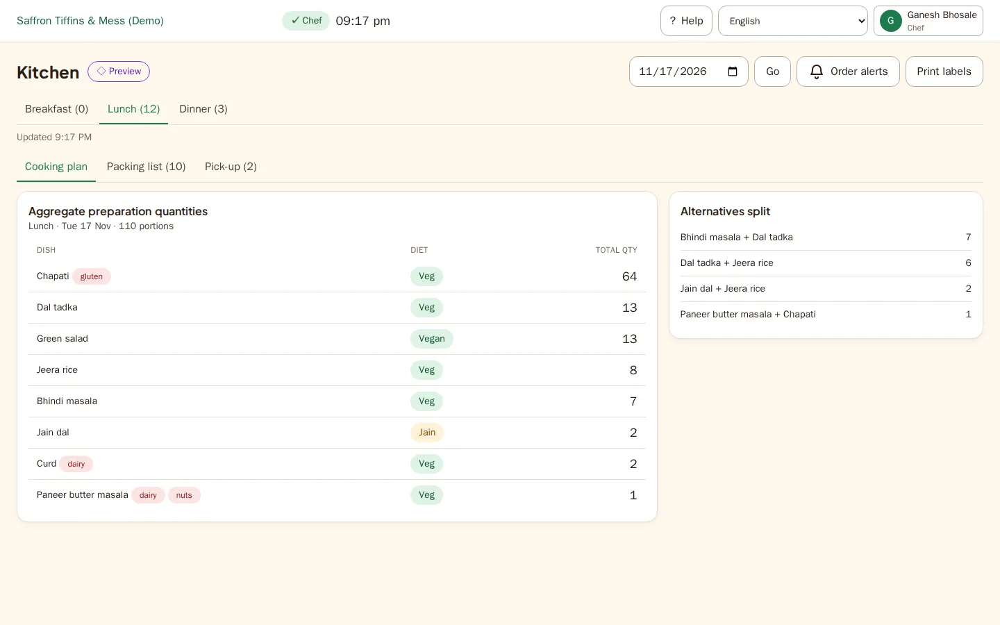
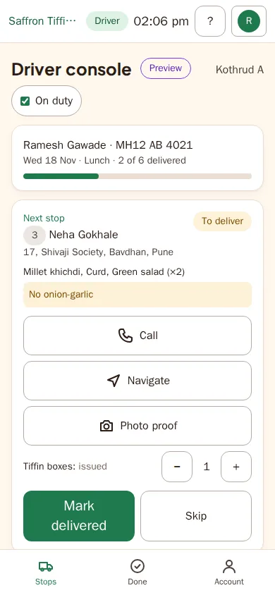
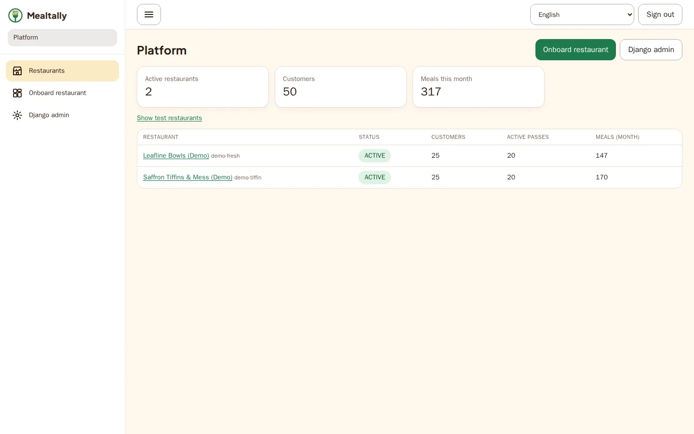
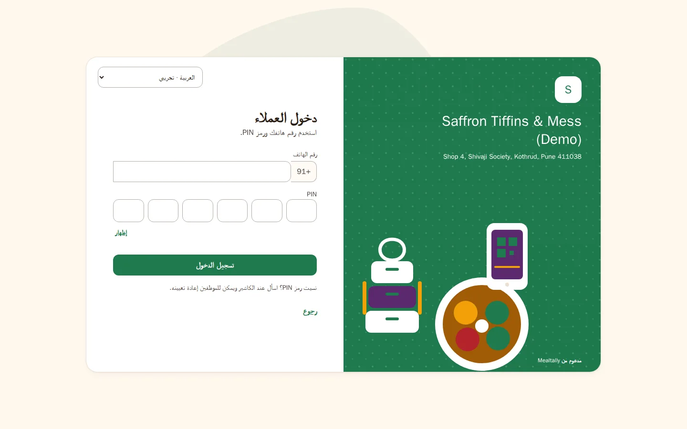

<p align="center"></p>

Mealtally runs prepaid meals for restaurants, messes, tiffin services, canteens and cloud kitchens. Customers buy a
pass for a number of meals; at the counter, staff scan the customer's QR code and one meal comes off the balance.
Owners see who ate what and when, what was sold, and what expired.

It runs on your own server or a small computer at the restaurant, in a browser on any phone. It is free software
under the AGPL-3.0.

Mealtally is not affiliated with mealtally.com.

## Who it's for

- **Messes and dine-in restaurants** selling monthly meal passes, redeemed at the counter.
- **Tiffin services** whose customers pay in advance. Delivery features are in Preview (see below).
- **Canteens** that give teams prepaid meals and want simple reports.
- **Hosting providers** who want to offer Mealtally to many restaurants from one installation (multi mode).

## Screenshots

From the demo restaurants that `make demo` creates. Every screen, on desktop and phone, is in
[docs/screenshots](docs/screenshots/README.md).

| Role | |
|---|---|
| Counter: a meal redeemed |  |
| Customer: meals left and QR code |   |
| Owner: plans with meal times |  |
| Manager: dashboard |  |
| Chef: kitchen (Preview) |  |
| Driver: route (Preview) |  |
| Platform admin: restaurants |  |
| Sign-in in Arabic, right to left |  |

## What's ready and what's Preview

| Ready | Preview |
|---|---|
| Meal passes: plans, validity, meal times, daily limits, renewals | Wallets and top-ups |
| Redemption at the counter: QR scan, search, undo, override with a reason | Orders |
| Customer QR code and app (installable web app) | Kitchen: cooking plan, packing lists, labels |
| Receipts (numbered, PDF) | Delivery routes and the driver screen |
| Customers, staff and roles | Invoices |
| Audit log | Expenses and profit |
| Reports (CSV and PDF) | Notifications |
| One restaurant or many (multi mode) | Cloud kitchen |
| Three themes | The restaurant's own website |
| 13 languages (English, and 12 in Beta), right to left | |

**Preview** modules are screens filled with sample data, so you can see where Mealtally is going. They don't save
anything and are labelled "Preview" on every screen. They are off unless you set `MEALTALLY_DEMO_DATASET=on` or use
`make demo`.

## Quick start

You need Docker with Compose v2, `make` and git. In the repository folder:

```bash
cp .env.example .env
```

Set `MEALTALLY_ADMIN_EMAIL` in `.env` to your email, then:

```bash
make init
```

```bash
make up
```

`make init` asks for your restaurant's country, currency and time zone (or set `MEALTALLY_DEFAULT_COUNTRY`,
`MEALTALLY_DEFAULT_CURRENCY` and `MEALTALLY_DEFAULT_TIMEZONE` in `.env` first). Open http://localhost:8000 and sign
in with the email and the password that `make init` printed. You'll be asked to
choose your own password.

To look around with sample data first, set `MEALTALLY_ENV=development` in `.env` before `make init`, then run
`make demo`. It creates two demo restaurants and writes their logins to `.demo-credentials`.

`make help` lists the other commands.

## Configuration

Everything is set through environment variables in `.env`. The ones you are most likely to change:

| Variable | Default | |
|---|---|---|
| `MEALTALLY_BASE_URL` | `http://localhost:8000` | The address people type. `https://` turns on secure cookies and HSTS. |
| `MEALTALLY_MODE` | `single` | `multi` to host several restaurants. |
| `MEALTALLY_DEFAULT_COUNTRY`, `_CURRENCY`, `_TIMEZONE` | none: `make init` asks | Country (ISO 3166), currency (ISO 4217) and time zone of new restaurants. Each restaurant can change them in Settings. |
| `MEALTALLY_DEFAULT_LANGUAGE` | `en` | Language for people who haven't picked one. |
| `MEALTALLY_TRUST_PROXY` | `false` | `true` behind a reverse proxy. |

The full list is in [docs/configuration.md](docs/configuration.md).

## How it works

**Restaurants are isolated by the database.** Every restaurant's rows are protected by PostgreSQL row-level security,
and the application connects as a role that can't bypass it. A bug in a query can't show one restaurant's customers
to another.

**Meals are a ledger.** Every meal issued, redeemed, undone or expired is a row in an append-only ledger; the
database rejects edits and deletes. A pass's balance is the sum of its rows, and corrections are new rows with a
reason. The audit log works the same way.

**QR redemption.** The customer's app shows a QR code that changes every 90 seconds and works once. The counter
scans it with the phone camera, or staff search by name, phone or customer code. Before a meal comes off, Mealtally
checks the pass, the meal time, whether this meal was already served today, and the daily limit. Two counters
scanning the same code at the same moment give one meal.

**Roles.** Owners manage everything; managers run the day and can override meal rules; counter staff redeem meals
and sell passes; customers see their own meals and QR code. Chef and driver roles exist for the Preview kitchen and
delivery screens.

**Themes.** Three colour themes (Masala, Fresh, Mealtally) chosen per restaurant. Every text colour meets WCAG AA
contrast in every theme, checked by a test.

**Money and countries.** Amounts are whole numbers of the currency's smallest unit, formatted with Unicode CLDR data
for the restaurant's country: `₹1,24,325.00` in India, `$124,325.00` in the US, `¥124,325` in Japan. Phone numbers,
tax-ID labels (GSTIN, VAT number, tax ID) and payment methods follow the restaurant's country too.

More detail in [docs/architecture.md](docs/architecture.md).

## Languages

English is the source language. हिंदी (Hindi) is fully translated and in Beta until its review is finished. Marathi,
Tamil, Telugu, Bengali, Gujarati, Kannada, Spanish, French, Brazilian Portuguese, Arabic and Indonesian are in Beta:
the screens people use most are translated (drafts, waiting for review by native speakers) and the rest is in
English. Arabic is shown right to left. Each person picks a
language on any screen; a restaurant sets a default for everyone else.

Corrections and new languages are welcome: [TRANSLATING.md](TRANSLATING.md).

## Running it for real

On a private network, plain HTTP works with one limit: phones only allow the camera (for QR scanning) and app
installation on HTTPS, so on `http://192.168.x.x:8000` staff type the code under the QR instead of scanning it.
[docs/deploy.md](docs/deploy.md) shows how to add HTTPS with Caddy, Traefik or nginx, and how to run the released
images.

**Whoever runs an instance is responsible for the personal data in it**: the data controller under the GDPR, the
data fiduciary under India's DPDP Act. The privacy notice and terms pages are templates
(`mealtally/templates/legal/`) that you adapt with your own details and have reviewed. They stay hidden until you turn
them on and fill in the required details.

### Backup and restore

The production setup makes a database dump every night and keeps 14 days of them in `./backups/`. Copy that folder
and your `.env` somewhere else. With `compose.prod.yml`, put `COMPOSE_FILE=compose.prod.yml` in front of these
commands.

```bash
make backup
```

```bash
make restore FILE=backups/mealtally-20261117T203000Z.dump
```

See [docs/deploy.md](docs/deploy.md#backups) for the details.

### Upgrading

Set the new image version in `.env`, then `make upgrade`: it pulls the image, backs up the database and restarts.
Version notes are in [docs/upgrading.md](docs/upgrading.md).

### Requirements

- Docker with Compose v2, on amd64 or arm64
- PostgreSQL 16 or newer, if you use your own instead of the bundled PostgreSQL 18
- Valkey or Redis 7 or newer, if you use your own instead of the bundled Valkey 8
- Python 3.14, only for development outside Docker

## Security

Report vulnerabilities privately; see [SECURITY.md](SECURITY.md).

## Roadmap

Planned, roughly in this order: online payment gateways, notifications (email, SMS, WhatsApp), wallets and orders as
working features, customer self sign-up with verification, mobile apps, and biometric sign-in on the counter device.
None of this has a date.

## Contributing

Bug reports, fixes and translations are welcome. Read [CONTRIBUTING.md](CONTRIBUTING.md); you'll be asked to sign
the [CLA](CLA.md) on your first pull request.

## Licence

Mealtally is licensed under the [GNU Affero General Public License v3.0 only](LICENSE). If you change it and let
people use it over a network, you must offer them your changed source code. For other terms, see
[COMMERCIAL.md](COMMERCIAL.md).

The name and logo are not covered by the code licence; see [TRADEMARK.md](TRADEMARK.md). Third-party components and
their licences are listed in [THIRD_PARTY_LICENSES.md](THIRD_PARTY_LICENSES.md).
